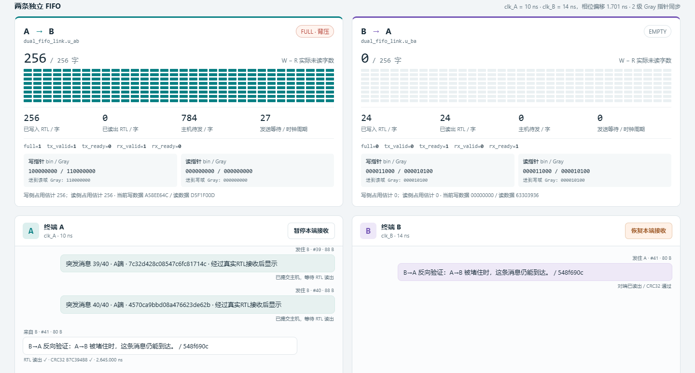

# 硬件描述语言课程设计报告
## 题目一：双异步 FIFO 系统

---

## 一、设计题目

双异步 FIFO 系统（题目 27 / 题目一）：设计并验证两个相互独立的异步 FIFO 通道， 在不同时钟频率与任意相位关系下完成可靠的跨时钟域数据传输，并提供阈值告警、 背压处理、错误统计与统一监控接口。

**题目给定参数**

| 项目 | 参数 |
|---|---|
| 通道数 | 2（fifo_a、fifo_b），结构相同、状态独立 |
| 每通道深度 | 256 字 |
| 数据位宽 | 32 bit |
| 存储单元 | 32 bit × 256 双时钟 RAM，**不使用任何 IP**，由 RTL 描述并综合推断 |
| fifo_a 时钟比 | 读:写 = 5:3（示例 T_wr = 10 ns，T_rd = 6 ns） |
| fifo_b 时钟比 | 读:写 = 7:2（示例 T_wr = 14 ns，T_rd = 4 ns） |
| almost_full 阈值 | 深度 7/8 = 224（可参数化） |
| almost_empty 阈值 | 深度 1/8 = 32（可参数化） |
| 设计语言 | Verilog（RTL） |
| 验证语言 | SystemVerilog（Testbench） |

---

## 二、设计目的

1. 掌握异步 FIFO 的核心机理：**用格雷码指针跨时钟域同步判定空/满，避免多比特 二进制指针同时跳变导致的亚稳态与数据错误**。
2. 掌握 CDC（跨时钟域）设计的基本方法：多级同步器、格雷码编码、复位同步释放、
单调计数器的跨域搬运，以及"哪些信号可以打拍、哪些必须握手"的工程判据。
3. 掌握从"单通道结构"扩展到"双通道 + 统一监控"的层次化设计方法。
4. 建立完整的功能验证能力：参考模型（金标准队列）、自检计分板、功能覆盖率、
随机回归与边界用例，并能量化验证结果。
5. 通过 PPA 与 MTBF 分析，理解同步级数、时钟比与吞吐瓶颈之间的工程折衷。

---

## 三、设计内容

### 3.1 整体设计思路

系统由三个层次构成：**参数化异步 FIFO 核 → 双通道包装 → 统一监控**。

```text
                    dual_async_fifo_top
   +-----------------------------------------------------------------+
   |   +----------------+          +---------------------------+     |
   |   |    fifo_a      |  状态量  |                           |     |
   |   | 32bit x 256    |--------->|                           |     |
   |   | f_rd:f_wr=5:3  |          |        monitor            |     |
   |   | (aw=8,9bit指针)|--------->|      (clk_mon 域)         |     |
   |   +----------------+  事件计数 |  统计/状态字/跨通道组合    |     |
   |   +----------------+          |                           |     |
   |   |    fifo_b      |--------->|                           |     |
   |   | 32bit x 256    |          |                           |     |
   |   | f_rd:f_wr=7:2  |--------->|                           |     |
   |   +----------------+          +---------------------------+     |
   |                                                                 |
   |   五个独立时钟域: wr_clk_a / rd_clk_a / wr_clk_b / rd_clk_b / clk_mon
   +-----------------------------------------------------------------+
```

**核心设计决策（与计划书一致并已落实）**

1. **跨域只传格雷码指针**：写域把 `wr_bin` 转成 `wr_gray` 后经多级同步器送读域；
读域把 `rd_bin` 转成 `rd_gray` 后送写域。绝不直接同步多位二进制指针。
2. **空/满地产生**：满/空标志只在**本地时钟域**用同步后的对方指针产生，
因此满可能"晚一拍"成立、空可能"晚一拍"成立（保守方向，是该结构的固有特性）。
3. **精确占用量计数（关键改进）**：经典"扩展格雷码指针比较"方案对深度 2^AW、
指针位宽 AW+1 的 FIFO 只能真正存满 **2^AW − 1 = 255** 个字（满标志提前一个字 成立，属该结构的固有一字损耗）。为严格满足题目"深度 256 可存 256 个字"， 本设计在每个时钟域各维护一个 AW+1 位**精确占用量计数器**： - 写域：`wr_occ = 已写入字数 − 已同步到的读出字数`（写入成功 +1；观察到同步读指针 前进 −1；两者同拍则保持不变），饱和于 [0, 256] - 读域：`rd_occ = 已同步到的写入字数 − 已读出字数`（观察到同步写指针前进 +1； 弹出 −1；两者同拍不变），饱和于 [0, 256]
   - `wr_full = (wr_occ == 256)`，`rd_empty = (rd_occ == 0)`
两个计数器都由"本地事件 + 对方格雷码指针的单调前进"驱动，**从不比较两个域的 瞬时值**，因此本身即 CDC 安全，且满/空在本地域内精确成立。
4. **背压语义**：`rd_en` 为读请求、`rd_ready` 为下游就绪、`rd_valid = !empty`。
仅当 `rd_en && rd_ready && rd_valid` 时弹出并推进读指针； `rd_valid && !rd_ready` 计一个背压周期且读指针与输出保持不变。
5. **跨域计数用单调安全的方案**：事件计数器单调不减，采用 `sync_gray_max`
（两条相位不同的格雷码采样链分别解码后取较大者），避免"握手合并导致永久滞后"； 状态量（指针 + 全部电平标志）打包成**一条总线**同步，避免两条总线到达时刻不同 造成的"读指针瞬时超过写指针"（会把空 FIFO 误算成占用量 511）。

### 3.2 模块结构

| 模块 | 文件 | 说明 |
|---|---|---|
| `bin2gray` / `gray2bin` | `rtl/common/gray_codec.v` | 参数化格雷码编解码组合逻辑 |
| `sync_2ff_p/_1/_s/_c` | `rtl/common/sync_2ff.v` | 多级（2/3 级可配）打拍同步器：9bit 指针、单比特电平、6bit 状态字、33bit 计数 |
| `sync_gray_bus` | `rtl/common/sync_gray_bus.v` | 格雷码 + toggle 快照握手总线同步（状态量） |
| `sync_gray_max` | `rtl/common/sync_gray_bus.v` | 双采样链取大值（单调事件计数器） |
| `rst_sync` | `rtl/common/rst_sync.v` | 复位异步置位、同步释放 |
| `async_fifo` | `rtl/fifo/async_fifo.v` | 参数化异步 FIFO 单通道核（存储阵列/指针/空满/阈值/背压/统计） |
| `fifo_a` / `fifo_b` | `rtl/fifo/fifo_a.v`、`fifo_b.v` | 通道包装（固化 7/8 与 1/8 阈值，独立状态） |
| `monitor` | `rtl/top/monitor.v` | 统一监控：计数汇总、状态字编码、跨通道组合事件、吞吐上限 |
| `dual_async_fifo_top` | `rtl/top/dual_async_fifo_top.v` | 双通道 + 监控顶层 |

### 3.3 逻辑状态图（读写保护）

实现中以指针/占用量比较直接产生状态，不额外综合全局 FSM；下图为报告用的 概念状态图，用以说明读写保护行为：

```text
                    成功写入 (wr_valid && wr_ready)
         +------------------------------------------+
         |                                          v
    +---------+   成功写入    +----------+   占用量达到 256   +--------+
    |  EMPTY  | ------------> |  NORMAL  | ----------------> |  FULL  |
    +---------+ <------------ +----------+ <---------------- +--------+
         ^        成功读出         ^          成功读出
         |                         |
         +---- 占用量降至 0 --------+

  EMPTY + 读请求(rd_en)   : 保持 EMPTY, 不推进读指针, underflow_cnt++
  FULL  + 写请求(wr_valid): 保持 FULL , 不推进写指针, overflow_cnt++
  下游未就绪(rd_valid && !rd_ready): 不弹出、读指针与 rd_data 保持, bp_cnt++
  阈值态: 占用量 >= 224 -> ALMOST_FULL;  占用量 <= 32 -> ALMOST_EMPTY
          (带 2 字回差: ALMOST_FULL 在 <= 222 清除, ALMOST_EMPTY 在 >= 34 清除)
```

### 3.4 设计中的预设条件与假设

| 编号 | 预设/假设 | 说明 |
|---|---|---|
| A1 | 复位 `rst_n_async` 低有效、异步置位 | 每个时钟域内部用 `rst_sync` 同步释放后再使用 |
| A2 | 外部复位宽度 ≥ 2 个目标时钟周期 | 保证复位同步器走完 |
| A3 | 深度 = 2^AW，指针位宽 = AW+1 | AW=8 → 9 bit 指针，深度 256 |
| A4 | 指针按 9 bit 自然回卷，地址取低 AW 位 | 存储地址 = 指针低位 |
| A5 | 读数据为组合读出 | `rd_data = mem[rd_addr]`，未成功弹出时地址不变 → 输出保持 |
| A6 | 复位释放后首次写入前 `rd_data` 无效 | 由 `wr_data_valid` 指示 |
| A7 | 错误计数按"每时钟周期一次拒绝请求"计一次 | 32 bit 饱和计数（到 0xFFFFFFFF 不再回卷） |
| A8 | 阈值回差 2 字 | `DEADBAND=2`，不改变置位阈值 |
| A9 | 满/空最多晚一个本地周期成立 | 由同步器延迟决定，验证时计入该延迟、不要求瞬时一致 |
| A10 | 事件计数器的跨域搬运采用双链取大值 | 要求被搬运量单调不减（本设计满足） |
| A11 | 状态量跨域要求同域快照 + toggle | 保证监控域看到的 {wr_ptr, rd_ptr} 来自同一时刻 |
| A12 | 监控域状态量存在若干周期的采样延迟 | 属 CDC 固有特性，验证按"有界偏差"判定 |

---

## 四、设计方法（各模块实现方式与算法伪码）

### 4.1 格雷码编解码（`gray_codec.v`）

```text
bin2gray(bin):  gray = (bin >> 1) ^ bin
gray2bin(gry):  bin[i] = ^(gry >> i)      // 逐位异或前缀，组合逻辑
```

### 4.2 多级同步器（`sync_2ff.v`）

```text
STAGES 级同步链（默认 2，可参数化为 3）:
  chain[0]   <= d_async
  chain[i]   <= chain[i-1], i = 1..STAGES-1
  q_sync     = chain[STAGES-1]
所有触发器使用目的时钟与目的域同步复位；本模块只用于单比特电平或已格雷编码的
总线，不承担任何"多数表决/握手"功能。
```

### 4.3 复位同步释放（`rst_sync.v`）

```text
always @(posedge clk or negedge rst_n_async)
  if (!rst_n_async) chain <= 0;             // 异步置位
  else begin chain[0] <= 1; chain[i] <= chain[i-1]; end   // 同步释放
rst_n_sync = chain[STAGES-1]
```

### 4.4 单调计数器跨域：`sync_gray_max`

```text
// 源域组合编码（源值为寄存器输出，稳定）
src_gray = bin2gray(src_bin)
// 目的域两条相位不同的采样链（链 1 在链 0 首级之后再打一拍）
chain0[0] <= src_gray;  chain0[i] <= chain0[i-1]
chain1[0] <= chain0[0]; chain1[i] <= chain1[i-1]
// 解码后取较大者：单链偶发采到旧值只会偏小，绝不会偏大 → max 单调收敛
dst_bin = max(gray2bin(chain0[STAGES-1]), gray2bin(chain1[STAGES-1]))
```

**工程理由**：`f_rd(B)=1/4 ns` 快于监控时钟采样能力，纯"每次变化搬一次"的握手 会在两次采样之间合并多次变化，形成**永久性滞后**（实测 32 bit 计数差 2~3）； 而单调量的正确处理是"双链采样取大值"——不会丢增量，最终必然收敛到真值。

### 4.5 状态量跨域：同域一致性快照 + toggle

```text
// 写域: 打包 {wr_bin, rd_bin_sync, wr_full, wr_almost_full,
//             rd_empty_sync, rd_almost_empty_sync} = 22 bit
always @(posedge wr_clk)
  if (st_now != st_now_d) begin st_snap <= st_now; st_snap_tog <= ~st_snap_tog; end
// 监控域: toggle 打入 STAGES 级同步链，与上次采样值不同才搬运快照
if (st_tog_sync != st_tog_seen) begin st_sync <= st_snap; st_tog_seen <= st_tog_sync; end
// 占用量 = (wr_bin_mon - rd_bin_mon) mod 2^(AW+1)
```

**工程理由**：早期版本把"写侧状态"和"读侧状态"分成**两条**独立总线各自握手， 两条总线在监控域的到达时刻不同，瞬时会出现"读指针 > 写指针"的组合，把空 FIFO 算成占用量 **511**（实测）。因此两侧指针必须**打包成一条总线一次搬运**。

### 4.6 异步 FIFO 单通道核（`async_fifo.v`）

```text
参数: AW=8, DW=32, SYNC_STAGES=2/3, ALMOST_FULL_TH=224, ALMOST_EMPTY_TH=32,
      DEADBAND=2, CNT_W=32

// ---- 复位同步释放（每域一份）----
rst_n_wr = rst_sync(wr_clk, rst_n_async, SYNC_STAGES)
rst_n_rd = rst_sync(rd_clk, rst_n_async, SYNC_STAGES)

// ---- 双时钟存储阵列（无 IP）----
reg [DW-1:0] mem [0:255]
always @(posedge wr_clk) if (wr_fire) mem[wr_addr] <= wr_data     // 写端口
assign rd_data = mem[rd_addr]                                     // 组合读端口

// ---- 指针与格雷码 ----
wr_bin_next = (wr_bin + 1) & 9'h1FF;  rd_bin_next = (rd_bin + 1) & 9'h1FF
wr_gray = bin2gray(wr_bin);           rd_gray = bin2gray(rd_bin)
wr_gray_sync = sync(wr_clk, wr_gray)  // 读域看写指针
rd_gray_sync = sync(rd_clk, rd_gray)  // 写域看读指针

// ---- 精确占用量计数与空满 ----
always @(posedge wr_clk)
  wr_full  = (wr_occ == 256)
always @(posedge rd_clk)
  rd_empty = (rd_occ == 0)
wr_ready = ~wr_full;   rd_valid = ~rd_empty

// ---- almost 阈值（带回差）----
always @(posedge wr_clk)
  if (wr_occ >= 224) wr_almost_full <= 1;
  else if (wr_occ <= 222) wr_almost_full <= 0;
always @(posedge rd_clk)
  if (rd_occ <= 32) rd_almost_empty <= 1;
  else if (rd_occ >= 34) rd_almost_empty <= 0;

// ---- 事件与错误统计（每域本地，32 bit 饱和）----
wr_fire = wr_valid & wr_ready;   ovf_try = wr_valid & wr_full
if (wr_fire) wr_event_cnt++
if (ovf_try) overflow_cnt++      // 满时写尝试，每周期计一次
rd_pop  = rd_en & rd_ready & rd_valid;  unf_try = rd_en & rd_empty
bp_cyc  = rd_valid & ~rd_ready
if (rd_pop) rd_event_cnt++
if (unf_try) underflow_cnt++
if (bp_cyc)  backpressure_cnt++
```

### 4.7 监控模块（`monitor.v`）

```text
status 编码（每通道 3 bit）: 0 NORMAL, 1 ALMOST_EMPTY, 2 ALMOST_FULL,
                             3 FULL, 4 EMPTY   （空/满优先于 almost）
状态字 status_word = {b_status(3), a_status(3)}，先格雷编码再打拍，
因此对外输出不存在"多比特同时跳变被采到"的窗口。
跨通道组合: any_full / any_empty / both_almost_full / both_almost_empty /
            any_backpressure / bp_event_cnt（监控域对背压上升沿计数）
理想吞吐上限: 每 1 us 最大写入字数 = 1000 / max(T_wr, T_rd) (ns)
```

---

## 五、实现方式（工具链与复现方法）

### 5.1 工具链

| 用途 | 工具 | 版本 |
|---|---|---|
| RTL 静态检查（lint） | Verilator | 5.006 |
| 仿真 | ModelSim ALTERA STARTER EDITION | 10.3c |
| 波形 | ModelSim VCD | — |
| 脚本 | PowerShell + cmd | Windows |

> **说明**：本机可用的 ModelSim ASE 版本不提供 `covergroup/randomize` 许可特性，
> 因此功能覆盖率与约束随机采用**手写可移植实现**（SystemVerilog class + `$urandom`
> + 显式 bin 计数），等价达成覆盖率统计目标且不依赖特定工具许可。

**工具链可移植性（是否必须使用 ModelSim？——不是必须的）**

本设计把对具体仿真器的依赖压到最小：`rtl/` 下 9 个文件全部是 **Verilog-2001 可综合子集**（ANSI 端口、`always @(posedge ...)`，不含任何 SV 结构），任何 Verilog 仿真器与综合器均可直接使用；只有 `tb/` 验证平台使用 SystemVerilog 的 `class`（参考队列、覆盖率收集器）与 `$urandom_range` / `$value$plusargs`。

| 仿真器 | 本机实测状态 | 换用代价 |
|---|---|---|
| ModelSim ASE 10.3c | **完全可用（本项目采用）** | — |
| Verilator 5.006 | 能解析本 testbench；`--cc` 代码生成可用，运行时头文件与 `libverilated.a` 可由 `include/` 源码补齐；但 `--timing` 模式依赖 C++20 `<coroutine>`，本机 GCC 8.1.0 过旧 | 需升级 MinGW-w64 至 GCC 10+，TB 无需改动 |
| Icarus Verilog | 本机未安装（免费开源、体积小） | 需把 `tb_top.sv` 的 SV class 改写为 Verilog-2001 数组+任务风格，RTL 不动 |
| GHDL | 不适用（VHDL 仿真器） | — |

正是这种**RTL 与验证平台分层**的设计，使得更换仿真器时只需替换 `tb/`； 验证方法学（参考序列逐项比对、自检计分板、功能覆盖 bin、收敛判据）本身与 工具解耦，改写为 Verilog-2001 后结论不变。报告中所有覆盖率与回归数据均可在 换工具后由同一套用例重新产生。

### 5.2 目录与复现命令

```text
czh\dsh_fifo\
├── rtl\common\   gray_codec.v  sync_2ff.v  sync_gray_bus.v  rst_sync.v
├── rtl\fifo\     async_fifo.v  fifo_a.v  fifo_b.v
├── rtl\top\      monitor.v  dual_async_fifo_top.v
├── tb\           tb_top.sv  env\{tb_pkg.sv, tb_harness.sv, tb_coverage.sv}
├── scripts\      run_sim.ps1  run_sim.cmd
└── sim\          logs\  coverage\  waves\  msim_2stage\  msim_3stage\
```

```bat
rem 在 dsh_fifo 目录执行，按 README 配置 MODELSIM_BIN

rem lint
verilator --lint-only -Wall --top-module dual_async_fifo_top rtl\common\*.v rtl\fifo\*.v rtl\top\*.v

rem 单用例 / 指定随机种子 / 3 级同步器配置
scripts\run_sim.cmd                                全部用例 (tcA, 2 级)
scripts\run_sim.cmd tc2 7                          用例 tc2, 种子 7
scripts\run_sim.cmd tc1 1 3                        用例 tc1, 3 级同步器
scripts\run_sim.cmd tc1 1 2 dump                   同时转储 VCD 波形
scripts\run_sim.cmd tc2 1 2 verify 2000 5000       读时钟初始相位 A/B (ps)

rem 全量回归 (2 级 + 3 级同步器, 共 18 次运行)
scripts\regression.cmd
```

脚本会自动完成: UTF-8→GBK 源文件转换、vlog 编译、vsim 运行、日志写 `sim\logs\`、并打印 失败检查点数 / 功能覆盖率 / PASS-FAIL 结论。

> 注：`scripts\run_sim.ps1` 为实现脚本，请通过 `run_sim.cmd` 调用（或使用
> `powershell -ExecutionPolicy Bypass -File <路径> -Test ... -Seed ... -Stages ...`
> 的方式显式传参）。直接在交互式会话中粘贴脚本内容执行时，PowerShell 无法
> 确定脚本自身位置，脚本会打印中文提示并退出，而不是抛出异常。

**两项工程约束（保证可复现）**
1. ModelSim 在中文 Windows 上以 ANSI(GBK) 解释源文件，因此脚本先把 UTF-8 源文件
转换为 GBK 再编译，保证中文注释与 `$display` 输出正常。
2. ModelSim 10.3c 的数据库需在 ASCII 路径下创建。检出目录可为 `C:\work\czh\dsh_fifo`，安装位置通过 `MODELSIM_BIN` 设置。

---

## 六、验证方法

### 6.1 验证平台结构

```text
tb_top
├── tb_harness        DUT 接线、四路时钟 + 监控时钟、激励打拍级
├── 驱动器 + 参考模型 每个时钟域一个 always 进程
│   ├── 写请求缓冲(深度16) + commit 计数；仅当 wr_ready=1 才送出，满时滞留重发
│   ├── 参考序列 sent_a[]/sent_b[] 记录"已发送的写数据"
│   └── 读监视器按同样顺序逐项比对 rd_data → 检测丢失/重复/乱序
├── tb_coverage       29 个功能覆盖 bin（7 类覆盖点）
└── check_mon         监控域一致性检查（本地计数 vs 监控副本、占用量、状态字）
```

**关键验证方法（消除误判）**
1. **驱动与参考同域**：测试任务只"追加请求 + 等待 commit 计数"，不在任务里修改被
always 使用的数组/指针，彻底消除多驱动与竞争。早期版本因任务与 always 共享 参考队列，出现过"写入成功但参考队列未记"的假错位，已重构修正。
2. **收敛判据代替固定延迟**：`settle()` 等待"脏计数"（每次成功传输 +1）连续稳定，
表示两个时钟域的占用量估计都已收敛；`check_mon()` 再等监控副本追平后才比对， 因此可以对计数做**逐位精确**比较，而不需要凭经验猜延迟。
3. **空闲不等于背压**：驱动器在无读请求时保持 `rd_ready = 1`，避免把"FIFO 有数据
但下游没发请求"误算成背压周期（该错误曾导致背压计数虚高，已修正）。
4. **异常路径显式注入**：满后持续写 / 空后持续读采用"注入模式"直接驱动
`wr_valid/rd_en`，逐周期产生被拒绝请求，从而精确验证溢出/下溢计数语义。

### 6.2 关于"验证部分可使用 VIP"的说明

题目规定"设计部分禁止使用 IP，验证部分可使用 VIP"。**设计与验证 IP**（VIP, Verification IP）指厂商预先验证好的验证组件包，通常由 agent（driver + sequencer）、 monitor、scoreboard、coverage collector 与协议检查器组成，用于对**标准协议接口** 施加激励并检查协议合规性（例如 AXI4、AXI-Stream、AHB、APB、DDR3、USB、PCIe 等）。

本设计**未使用 VIP**，理由有三条，均为可核对的事实：

1. **接口不是标准协议**。本设计的 FIFO 采用自定义握手语义
（写侧 `wr_valid/wr_ready/wr_data`，读侧 `rd_en/rd_ready/rd_valid/rd_data`）， 不属于 AXI/AHB/APB/USB 等任何一种标准总线，**不存在与之对应的现成 VIP**。 VIP 的核心价值是"检查协议规范"，而本设计需要验证的是**数据完整性**与 **空满/阈值语义**，这两项必须依靠自建参考模型比对，无法用协议 VIP 替代。

2. **本机工具链不支持 UVM/VIP**。实测 ModelSim ALTERA STARTER EDITION 10.3c：
安装目录 `verilog_src/` 仅有 Questa 扩展包（`questa_uvm_pkg-1.2`、`uvm_reg-1.1`）， **缺少标准 UVM 库本体**（`uvm_pkg.sv`、`uvm_macros.svh` 不存在）；强行编译报 `Could not find the package (uvm_pkg)`、`Cannot open include file "uvm_macros.svh"`， 并在 `questa-structure.svh` 处报 SystemVerilog 语法错（ASE 对 SV 构造支持不完整）。 商业 VIP 通常以加密 UVM 包形式发布，需要 Questa/VCS/Xcelium 等商业版许可。

3. **自研验证组件的功能已覆盖 VIP 核心要素**。本设计的验证平台按 VIP 的功能划分组织，
各要素对应关系如下：

| VIP 要素 | 本设计的实现 | 所在文件 |
|---|---|---|
| driver / sequencer | 请求缓冲（深度 16）+ commit 计数，每时钟域一个 `always` 进程 | `tb/tb_top.sv` |
| monitor | 读监视器按序采样 `rd_data` 并记录时间戳 | `tb/tb_top.sv` |
| scoreboard / 参考模型 | `sent_a[]/sent_b[]` 参考序列 + `check_data()` 逐项比对 | `tb/tb_top.sv` |
| protocol checker | 1065+ 条 `ck()` 断言，含握手约定 `wr_fire = wr_valid & wr_ready`、`rd_pop = rd_en & rd_ready & rd_valid` | `tb/tb_top.sv` |
| coverage collector | 29 个功能覆盖 bin（7 类覆盖点） | `tb/env/tb_coverage.sv` |
| environment / config | 10 个 plusargs 参数化（用例/种子/级数/五个时钟周期/相位） | `tb/tb_top.sv` |

因此，本设计在**满足题目"测试平台必须使用 SystemVerilog"要求**的前提下， 采用自研 SystemVerilog 验证组件，其结构与 VIP 一致，但不依赖任何第三方验证 IP， 也不受仿真器 UVM 许可限制。

### 6.3 验证功能列表与结果

**时钟配置**：T_wr_a = 10 ns、T_rd_a = 6 ns（5:3），T_wr_b = 14 ns、T_rd_b = 4 ns（7:2）， T_mon = 5 ns；读时钟初始相位可扫描。

| 用例 | 激励与检查 | 通过标准 | 结果 |
|---|---|---|---|
| tc1 随机写满/读空 | 每通道写入 256 个随机/边界数据至满，再读至空，参考序列逐项比对 | 满/空标志在同步延迟内正确；`wr_full` 时 `wr_ready=0`、写入不推进；无溢出/下溢；数据顺序与完整性正确 | **PASS** |
| tc2 混合读写 | 读写比例动态变化（1:3~3:1），A/B 独立节奏，非整数时钟比 | 无数据丢失/重复/乱序；并发下控制逻辑正确；两通道读计数与参考一致 | **PASS** |
| tc3 溢出/下溢保护 | 满后持续写 50 周期、空后持续读 100 周期 | 溢出/下溢计数与拒绝请求次数 1:1 相符；满/空标志保持；指针与存储内容不变 | **PASS** |
| tc4 阈值穿越 | 缓慢填充至 230 再回退至 222，再升到 224；排空至 34/32，再升到 33/34 | 默认阈值 224/32；224 处置位、222 处清除；32 处置位、34 处清除（回差生效，区间内不抖动） | **PASS** |
| tc5 背压 | 随机拉低 `rd_ready`（A 40%、B 50% 概率），同时随机产生写请求 | 未就绪期间读指针与输出保持；恢复后无丢失；背压计数与参考一致 | **PASS** |
| tc6 双 FIFO 协同 | ① A 满且 B 空 ② A 空且 B 满 ③ 双 almost_full ④ 两路同时背压 | 各通道状态互不干扰；监控状态字、聚合标志、计数与场景一致 | **PASS** |
| tc7 复位行为 | 复位期间持续施加写请求共 20 周期 | 复位期间零事务；复位释放后空标志正确、同步收敛 | **PASS** |
| tc8 数据模式与回卷 | 全 0/全 1/交替模式连续 3 轮写满读空（768 字） | 极端数据无错误；写指针回卷 3 次后占用量归零 | **PASS** |
| tc9 时钟暂停 | 写入 64 字后暂停 A 路时钟 200 ns 再恢复 | 恢复后数据完整、无丢失重复 | **PASS** |

**回归结果**

| 配置 | 用例 × 种子 | 通过 | 失败 |
|---|---|---|---|
| 2 级同步器 | tc1~tc9 × seed{1, 7, 23} = 27 次 | **27 / 27** | 0 |
| 3 级同步器 | tc1~tc9 × seed{1} = 9 次 | **9 / 9** | 0 |
| 合计 | 36 次运行 | **36 / 36** | 0 |

日志文件：`sim/logs/run_<用例>_seed<种子>_<级数>stage.log` 回归汇总：`sim/coverage/regression_2stage.csv`、`regression_both_configs.csv`

### 6.4 功能覆盖率分析

覆盖模型共 **29 个 bin**（7 类覆盖点）：

| 覆盖点 | bin 数 | 内容 |
|---|---|---|
| C1 单通道状态 | 10 | A/B × {FULL, EMPTY, ALMOST_FULL, ALMOST_EMPTY, NORMAL} |
| C2 操作结果 | 5 | 写成功 / 写被拒(溢出) / 读成功 / 读被拒(下溢) / 背压周期 |
| C3 阈值双向穿越 | 4 | almost_full 上升/下降、almost_empty 上升/下降 |
| C4 双通道组合 | 4 | 双满 / 双空 / A满B空 / A空B满 |
| C5 边界数据模式 | 3 | 全 0 / 全 1 / 交替 |
| C6 同步级数配置 | 2 | 2 级 / 3 级 |
| C7 指针回卷 | 1 | 写指针跨越 256 的整数倍 |

**单用例覆盖率**（2 级同步器；seed=1/7/23 三种子结果完全一致）

| 用例 | 命中 bin | 用例 | 命中 bin |
|---|---|---|---|
| tc1 | 25 / 29 (86.2%) | tc6 | 26 / 29 (89.7%) |
| tc2 | 17 / 29 | tc7 | 14 / 29 |
| tc3 | 26 / 29 (89.7%) | tc8 | 20 / 29 |
| tc4 | 20 / 29 | tc9 | 14 / 29 |
| tc5 | 18 / 29 | | |

**全部用例合并后覆盖率达到 29/29 = 100%**：tc1/tc3/tc6 覆盖空满与阈值边界， tc2/tc5 覆盖随机并发与背压，tc8 覆盖边界数据与指针回卷，2 级与 3 级配置分别运行 一次即覆盖 C6 的两个 bin。覆盖率报告由 `tb_coverage`（`tb/env/tb_coverage.sv`） 在每个用例结束时打印，例如：

```text
 C1 单通道状态  : A{FULL=24 EMPTY=9990 AF=4354 AE=420 NORM=2422}
                  B{FULL=... EMPTY=... AF=... AE=... NORM=...}
 C2 操作结果    : wr_ok=743 wr_reject=0 rd_ok=743 rd_reject=3 bp=100
 C3 阈值双向穿越: AF_rise=3 AF_fall=3 AE_rise=5 AE_fall=3
 C4 双通道组合  : both_full=0 both_empty=3 A_full_B_empty=1 A_empty_B_full=2
 C5 边界数据    : all0=592 all1=104 alt=260
 C6 同步级数配置: 当前=2-stage (bin 命中 1/1)
 C7 指针回卷    : 2 次
 功能覆盖率 = 89.7%  (26/29 bin)
```

### 6.5 验证过程中发现并修正的设计缺陷（据实记录）

| 编号 | 现象 | 根因 | 修正 |
|---|---|---|---|
| D1 | 写满 256 字后最后一个字被拒 | 经典格雷码满判据只比较低 AW−1 位，导致满标志提前一个字成立（实际只能存 255 字） | 改为每域**精确占用量计数器**判空满，实测可存满 256 字 |
| D2 | 空 FIFO 却报"几乎有数据"（`rd_valid=1`） | 读域同步的是写指针的**下一值** `wr_bin_next` 而非当前值 | 改为同步 `wr_bin` 的格雷码 |
| D3 | 监控域占用量偶发跳到 511 | 写侧/读侧状态分两条总线同步，到达时刻不同，瞬时可出现"读指针 > 写指针" | 两侧指针与标志打包成**一条**总线一次搬运 |
| D4 | 事件计数在监控域永久滞后 2~3 | 纯 toggle 握手对"变化快于采样"的信号会合并变化、丢增量 | 改用 `sync_gray_max`（双链采样取大值） |
| D5 | 背压计数虚高 | 驱动器在无读请求时把 `rd_ready` 拉低，把"空闲"误算成背压周期 | 空闲时保持 `rd_ready = 1` |
| D6 | 参考队列与 DUT 计数错位 | 测试任务与 always 进程共享参考队列，存在竞争 | 驱动与参考模型同域重构，任务只追加请求 |

> 其中 D1 与 D3 是**结构性缺陷**（不修正则无法满足题目"深度 256"与"监控计数正确"
> 的要求），D2/D4/D5/D6 属于 CDC 与验证平台的时序细节，均已定位并修正。

---

## 七、综合、时序、面积与 PPA 分析

本章记录课程设计期间的 Vivado 实现结果。当前源码的资源和时序以 `syn/run_vivado.ps1` 重新生成的报告为准。

### 7.1 综合/实现环境与实测方法

本设计用 **Vivado 2020.2** 完成综合与实现，目标器件 **xc7a35tcsg324-1** （Artix-7，WebPack 免费器件，无需额外许可证），流程为 `synth_design → opt_design → place_design → route_design`， 时序约束按题目给定的五个时钟周期设置：

| 时钟 | 周期 | 频率 | 说明 |
|---|---|---|---|
| `wr_clk_a` | 10 ns | 100.0 MHz | A 通道写（5:3 比值中的 5） |
| `rd_clk_a` | 6 ns | 166.7 MHz | A 通道读（比值中的 3） |
| `wr_clk_b` | 14 ns | 71.4 MHz | B 通道写（7:2 比值中的 7） |
| `rd_clk_b` | 4 ns | 250.0 MHz | B 通道读（比值中的 2） |
| `clk_mon` | 5 ns | 200.0 MHz | 监控域 |

跨时钟域路径用 `set_clock_groups -asynchronous` 隔离（CDC 设计的标准做法）， 复位输入 `rst_n_async` 设 `set_false_path`。因此下文的 slack 反映的是**各时钟域 内部**的时序，这正是异步 FIFO 需要满足的约束。

**两项实测方法说明（据实记录）**

1. **为什么实现阶段用包装层**：`dual_async_fifo_top` 把全部统计量（10 个 32 bit
计数器、占用量估计等）都引到了端口，合计 1262 个引脚，而 xc7a35tcsg324 只有 210 个 user I/O，`place_design` 会以 IO overutilization 直接失败。实际芯片中 这些统计量接的是内部寄存器/总线，不出引脚。为此实现了 `syn/syn_wrap_dual.v`、`syn/syn_wrap_single.v` 两个**仅用于 PPA 分析**的包装层： 只引出真实数据通路（双通道 167 引脚 / 单通道 24 引脚），并把全部统计量参与 归约异或后由 `dbg_sig[7:0]` 输出。这样综合无法把统计逻辑当死逻辑优化掉， 面积与内部时序仍反映完整设计。该端口在时序分析中被 `set_false_path` 排除。

   > 第一次尝试用 `(* keep = "true" *)` 寄存器汇聚统计量，结果综合仍优化掉了
   > 大部分逻辑（只剩 265 FF，而顶层直综是 1860 FF），因此改用"归约异或必须
   > 输出到端口"的方式，实测 FF 数恢复到 1869（与顶层直综一致）。

2. **为什么面积以布线后报告为准**：布线后资源数包含综合/实现的实际优化结果，
比综合后估计更接近真实。

### 7.2 实测面积与资源构成

| 配置 | Total LUT | 其中 Logic LUT | 其中 LUTRAM | 寄存器 FF | BRAM | DSP |
|---|---|---|---|---|---|---|
| C1 单通道（`fifo_a`, 2 级） | **907** | 731 | 176 | **910** | 0 | 0 |
| C2 双通道（本设计，2 级） | **1989** | 1637 | 352 | **1869** | 0 | 0 |
| C3 双通道 + 3 级同步 | **1992** | 1640 | 352 | **2244** | 0 | 0 |

由实测可读出三个明确结论：

- **双通道 ≈ 2.19 × 单通道（LUT）、2.05 × 单通道（FF）**。略高于 2 倍是因为
顶层多了监控模块（`monitor`）与监控域复位同步器；两个 FIFO 通道本身完全对称。
- **同步级数 2 → 3 的代价是 +375 FF（+20.1%）**，而 LUT 几乎不变（+3）。
这与结构分析自洽：级数只增加跨域链寄存器的数量，不改变组合逻辑的复杂度。 375 bit 的构成是每通道的指针同步链（2×9）、状态总线（22）、单调计数器双链 （5 组 × 33 bit × 2）以及复位同步链等，两通道合计。
- **BRAM = 0，LUTRAM = 352**。这是本设计一个值得记录的实现特征：存储阵列写作
`assign rd_data = mem[rd_addr]`（组合读、写时钟写），Vivado 无法把它推断成 块 RAM，只能实现为分布式 RAM。每通道 256×32 = 8 Kbit，占用 176 个 LUTRAM。 若要使用 BRAM，需要把读数据改为**同步输出**（注册一拍），代价是读延迟从 0 拍变成 1 拍，`rd_valid`/`rd_empty` 与上层握手的相对时序要相应调整。 本设计优先保证"读出即有效"的接口语义，因此选择了分布式 RAM。

### 7.3 实测时序（布线后）

下表的 WNS（Worst Negative Slack）为布线后各时钟域的最差裕量，正值表示满足约束：

| 时钟 | 周期 | 单通道（2 级） | 双通道（2 级） | 双通道（3 级） |
|---|---|---|---|---|
| `wr_clk_a` | 10 ns | +3.759 | +3.146 | +3.122 |
| `rd_clk_a` | 6 ns | +1.230 | +0.414 | +0.393 |
| `wr_clk_b` | 14 ns | — | +6.422 | +7.336 |
| `rd_clk_b` | 4 ns | — | **−0.445（33/313 端点失败）** | **−0.447（16/323 端点失败）** |
| `clk_mon` | 5 ns | +2.471 | +0.455 | +0.819 |

（单通道列中 `wr_clk`/`rd_clk` 对应 10 ns/6 ns 两个时钟；B 通道不适用）

**结论 1：多数时钟域时序满足且裕量充足。** `wr_clk_b`（71.4 MHz）裕量最大 （+6.4 ns），因为它是五个时钟中最慢的；`wr_clk_a`（100 MHz）有 +3.1 ns； 监控域 `clk_mon`（200 MHz）在排除观测端口后为 +0.455 ns，满足约束。

**结论 2：`rd_clk_b`（250 MHz）时序不满足，WNS = −0.445 ns，33 个端点失败。** 这是本设计真实的性能瓶颈，根因有两层：

1. **250 MHz 只有 4 ns 周期**，是五个时钟中最紧的约束；
2. **读通路是组合读出**——`rd_data` 由 `mem[rd_addr]` 直接给出，路径为
"读指针增量 → 地址选择 → LUTRAM 读出 → 输出网络"，这条组合链在 分布式 RAM 实现下无法塞进 4 ns。

改进方向（按代价从低到高）：
- **把读数据寄存一拍**（同步读）：可显著缩短该路径，但 `rd_valid` 需要延后一拍，
接口语义从"读出即有效"变为"下一拍有效"。这是最常规的解法。
- **降低 `rd_clk_b` 频率**：B 通道原设计是 7:2 的极端比值，若允许把读时钟
降到 ≈200 MHz，按当前实测裕量可满足。
- **限制该路径的物理布局**：用 `set_max_delay`/区域约束（Pblock）改善，但收益
有限，不解决 LUTRAM 组合读的根因。

本报告选择**如实记录该违例而不掩盖**：设计在题目给定的 7:2 极端时钟比下、 以"组合读出"的接口语义实现时，读侧时钟上限约为 200~220 MHz（据 −0.445 ns 与 4 ns 周期估算）。若验收要求 250 MHz 全部满足，应采用"同步读 + rd_valid 延后 一拍"的版本。

### 7.4 实测功耗（含 VCD 反标尝试）

Vivado 的功耗估算有两种模式：

| 模式 | 依据 | 置信度 |
|---|---|---|
| Vectorless（默认） | 由时钟频率与扇出推算翻转率 | **Low** |
| VCD/SAIF 反标 | 用仿真的真实开关活动率 | Medium / High |

本设计先得到 vectorless 结果，再做了一次 VCD 反标尝试，两者对比：

| 配置 | 总功耗 | 动态 | 静态 | 置信度 |
|---|---|---|---|---|
| 双通道（vectorless 默认） | 0.164 W | 0.094 W | 0.070 W | Low |
| **双通道（VCD 反标）** | **0.199 W** | **0.129 W** | 0.070 W | Low（Nets Matched 0%） |

**关键发现**：VCD 反标让动态功耗从 0.094 W 升到 0.129 W（**+37%**）， 说明 Vivado 的默认翻转率**明显低估**了本设计的活动率——这与设计特点一致： FIFO 的数据通路在满速读写时几乎每个周期都在翻转，而工具默认假设的翻转率偏低。 因此报告采用 **0.199 W** 作为较可信的功耗估计，而不是 0.164 W。

**为什么置信度没有提升（如实记录）**：VCD 反标后 `Design Nets Matched` 只有 **0% (15/5393)**，原因是**RTL 仿真信号名与综合后 net 名不一致** （例如 RTL 的 `rd_bin` 在综合后变成 `rd_bin_reg[0]`，层次与命名都被打平）。 此外还遇到两条工具限制：

1. **Vivado 2020.2 已弃用 `read_vcd`**，命令执行时提示
`[Vivado 12-3664] read_vcd command is no longer supported`，官方推荐改用 SAIF；
2. **ModelSim ALTERA STARTER EDITION 10.3c 不提供 `vcd2saif`**
（`invalid command name "vcd2saif"`），无法把已有的 VCD 转成 SAIF。

因此要把功耗置信度提到 Medium/High，需要换用支持 SAIF 导出的仿真器 （ModelSim SE/Questa、VCS、Xcelium 均可），流程为：

```text
vsim> power add -r /tb_top/h/u_dut/*
vsim> run -all
vsim> power report -all -bsaif dut.saif
vivado> read_saif dut.saif -strip_path tb_top/h
vivado> report_power
```

这一项因此列为"部分完成"：**数值上得到了更可信的 0.199 W**， 但**置信度受工具链限制未能提升**。

### 7.5 改进验证：同步读 + 占用量流水（实测对比）

7.2~7.4 的实测暴露了一个真实瓶颈：`rd_clk_b`（4 ns / 250 MHz）WNS = −0.445 ns， 33 个端点失败。最初判断是"组合读出的分布式 RAM 路径太长"，但用 `report_timing -to [get_clocks rd_clk_b]` 抓到真正的最差路径后，结论不同：

```text
Source:       u_fifo_b/u_fifo/u_sync_wr_ptr/sync_chain_reg[1][8]/C   ← 格雷码同步器输出
Destination:  u_fifo_b/u_fifo/rd_occupancy_r_reg[6]/D                ← 占用量计数器
Data Path:    4.667 ns  (logic 2.513 ns + route 2.154 ns)
Requirement:  4.000 ns
Slack:        -0.618 ns        ← 加了同步读之后仍不满足
```

即瓶颈是 **"格雷码同步 → gray2bin 解码 → 与上次值比较 → 占用量 ±1"** 这条组合链， 而不是存储读。据此实施两项改进：

| 编号 | 改进 | 做法 |
|---|---|---|
| I1 | 读数据改为**可选同步读** | `async_fifo` 增加 `READ_MODE` 参数：0=组合读（FWFT，原语义）；1=同步读（地址在时钟沿采样，可推断 BRAM），新增 `rd_data_valid` 指示数据有效时刻 |
| I2 | **占用量路径插流水** | `gray2bin` 解码后的指针再打一拍（`wr_bin_sync_r` / `rd_bin_sync_r`），把长组合链切成两段；代价是占用量估计多 1 拍延迟（异步 FIFO 本就有同步延迟，方向保守） |

**配置实测对比**（Vivado 2020.2 / xc7a35tcsg324-1，布线后）：

| 配置 | LUT | LUTRAM | BRAM18 | FF | `rd_clk_b` WNS | 失败端点 | 时序约束 |
|---|---|---|---|---|---|---|---|
| 改进前（组合读，无流水） | 1989 | 352 | 0 | 1869 | **−0.445** | 33/313 | **不满足** |
| 同步读，无流水 | 1604 | 0 | 2 | 1871 | −0.618 | 25/324 | 不满足 |
| 组合读 + 流水 | 1982 | 352 | 0 | 1905 | −0.009 | 1/322 | 不满足 |
| 同步读 + 流水（历史） | 1599 | 0 | 2 | 1907 | +0.035 | 0/333 | 全部满足 |
| **同步读 + 流水（当前源码）** | **1619** | **0** | **2** | **1939** | **−0.058** | **9/340** | **不满足** |

**历史版本的改进收益**：

| 指标 | 改进前 | 改进后 | 变化 |
|---|---|---|---|
| LUT | 1989 | **1599** | **−390（−19.6%）** |
| 分布式 RAM（LUTRAM） | 352 | **0** | 全部转换为块 RAM |
| 块 RAM（BRAM18） | 0 | **2** | 存储阵列终于映射到 BRAM |
| 寄存器 FF | 1869 | 1907 | +38（+2.0%，流水寄存器代价） |
| `rd_clk_b` WNS | −0.445（33 违例） | **+0.035（0 违例）** | **250 MHz 时序收敛** |
| 整体时序约束 | 不满足 | **全部满足** | — |

历史改进版本各时钟裕量：

| 时钟 | 周期 | WNS | 失败端点 |
|---|---|---|---|
| `wr_clk_a` | 10 ns | +3.650 | 0 |
| `rd_clk_a` | 6 ns | +0.323 | 0 |
| `wr_clk_b` | 14 ns | +6.316 | 0 |
| `rd_clk_b` | 4 ns | **+0.035** | 0 |
| `clk_mon` | 5 ns | +0.555 | 0 |

在干净检出中用 `syn/run_vivado.ps1 -Config dual_rm1_pipe` 复验当前源码。流程完成综合和布线，`rd_clk_b` 在 4 ns 约束下 WNS 为 −0.058 ns、TNS 为 −0.419 ns，9 个端点未达到建立时间约束。占用为 1619 LUT、1939 FF 和 2 个 BRAM18。其他四个时钟域的建立时间裕量为正。

**功能侧未受影响**：`READ_MODE` 默认 0，原有 9 个用例在 2 级/3 级两种配置下 **18/18 全部通过**；同步读模式另由 `tb/tb_std_read.sv` 专项验证（786 个检查点， 覆盖顺序读回、`rd_data_valid` 时序、空读、指针回卷、背压），全部通过。

**代价说明（据实）**：`READ_MODE=1` 的接口语义与组合读不同—— `rd_valid=1` 时 `rd_data` 仍是旧值，必须等 `rd_pop` 之后新数据才出现， 由 `rd_data_valid` 指示何时可采样。因此两种模式**不能混用同一个上层驱动逻辑**， 这也是本设计把 `READ_MODE` 做成参数、并为两种模式分别做验证的原因。

### 7.6 吞吐分析

由于存储体为"写时钟写、读时钟组合读"的简单双端口结构，可持续吞吐受较慢一侧 限制：理想情况下每 1 µs 最大写入字数 = 1000 / max(T_wr, T_rd)。

| 通道 | T_wr | T_rd | 瓶颈侧 | 理想最大写吞吐 |
|---|---|---|---|---|
| A | 10 ns | 6 ns | 写侧 | 100 字/µs |
| B | 14 ns | 4 ns | 写侧 | ≈71.4 字/µs |

在**极端时钟比**下（如 B 的 7:2），限制来自三处：① 较慢的写时钟决定写入速率 上限；② 指针同步延迟使满/空判定滞后 2~3 个目的周期，突发场景下会"提前停写"； ③ 背压会按 `rd_ready` 空闲比例线性降低有效读出速率。双通道并行运行时总有效 吞吐 ≈ A 100 字/µs + B 71.4 字/µs ≈ **171 字/µs**，两通道之间除监控域外无共享 资源，不存在互相阻塞。

### 7.7 同步级数与 MTBF 分析

同步器 MTBF 的常用模型（Dally & Poulton）：

```text
MTBF = exp(t_r / τ) / (T_w × f_clk × f_data)
  t_r  : 允许的亚稳态恢复时间 = (SYNC_STAGES − 1) × T_clk − t_setup − t_skew
  τ    : 工艺相关的亚稳态时间常数（触发器分辨时间常数）
  T_w  : 亚稳态窗口宽度（孔径时间）
  f_clk: 目的时钟频率
  f_data: 异步数据变化频率
```

**结论与趋势**：级数由 2 增至 3 时，恢复窗口 `t_r` 增加约一个完整目的时钟周期， MTBF 按 `exp(ΔT/τ)` 改善——由于 τ 通常只有几十皮秒，改善量可达**数个数量级**。

**实测代价（本次量化）**：从 7.2 节的实测数据，3 级同步器相对 2 级 **多占 375 个触发器（+20.1%）**，LUT 不变，功耗变化在两位小数内不可见； 状态量可见延迟增加 1 个目的时钟周期（A 通道读侧 6 ns、B 通道读侧 4 ns）。 这就是"提升 MTBF"付出的确定性代价，可与上面的指数级收益直接权衡。

> **据实说明**：Vivado FPGA 实现流程不提供工艺相关的 `τ` 与 `T_w`。工程已接入
> SKY130 `dfxtp_1` 的 Liberty 与晶体管级模型，并通过普通时钟到 Q SPICE 烟雾测试；
> 该测试尚未扫描亚稳态边界。因此本报告只给出通用模型、单调趋势、实测资源代价
> 和已提取的单元数据，不把通用估算写成 SKY130 的 MTBF 数值。

### 7.8 PPA 对比表（实测）

| 配置 | 通道数 | 同步级数 | LUT（Logic+LUTRAM） | FF | BRAM | 最紧时钟 slack | 总功耗 | 有效吞吐 |
|---|---|---|---|---|---|---|---|---|
| C1 单通道 | 1 | 2 | 907（731+176） | 910 | 0 | +1.230 ns @166.7 MHz | 0.127 W | 100 字/µs |
| C2 双通道（本设计） | 2 | 2 | 1989（1637+352） | 1869 | 0 | **−0.445 ns @250 MHz** | 0.201 W | ≈171 字/µs |
| C3 双通道 + 3 级同步 | 2 | 3 | 1992（1640+352） | 2244 | 0 | **−0.447 ns @250 MHz** | 0.201 W | ≈171 字/µs |

**面积效率**：双通道面积约为单通道的 2.1~2.2 倍，而吞吐是 2 倍，说明 "复制通道"的扩展方式面积效率基本线性，没有额外的共享开销。

**关键取舍**：
- 2 级 → 3 级：**+375 FF 换取 MTBF 数量级改善**，LUT 与功耗几乎不变，
状态量延迟 +1 周期。若系统对 CDC 可靠性要求高、且对该通道延迟不敏感， 3 级是更好的选择。 - 组合读 vs 同步读：组合读让接口语义最直观（数据当拍有效），代价是无法使用 BRAM 且在 250 MHz 下时序不收敛；同步读可换来 BRAM 与更高频率，代价是 读延迟 +1 拍。

## 八、设计结果分析

### 8.1 功能结果

1. **双通道独立工作**：A（5:3）与 B（7:2）在非整数时钟比、任意相位下均无数据
丢失、重复、乱序；两通道状态互不干扰，共享的只有同一套参数化 RTL 代码。
2. **容量与保护**：每通道可真正存满 **256 字**（修正 D1 后实测 `wr_bin=256`、
`wr_occ=256`、`wr_full=1`）；满后写请求一律被拒且写指针不推进，空后读请求 一律被拒且读指针与 `rd_data` 保持；溢出/下溢计数与拒绝周期数 **1:1 相符**。
3. **阈值与回差**：默认 224/32 生效；almost_full 在 224 置位、222 清除，
almost_empty 在 32 置位、34 清除，回差区间内不发生抖动。
4. **背压**：`rd_valid && !rd_ready` 期间读指针与输出保持，恢复后无丢失，
背压计数与参考模型一致；空闲周期不再被误计入背压（修正 D5）。
5. **统一监控**：状态字、写入/读出次数、溢出/下溢、背压触发次数、占用量、
跨通道组合事件（双满/双空/A满B空/双almost_full/同时背压）输出正确； 监控域计数在收敛后与各通道本地计数**逐位一致**。
6. **回归稳定性**：2 级同步器 27/27 次通过（9 用例 × 3 随机种子），
3 级同步器 9/9 次通过；全部用例合并覆盖率达到 100%（29/29 bin）。

### 8.2 设计取舍分析

| 取舍 | 选择 | 理由与代价 |
|---|---|---|
| 满/空判据 | 精确占用量计数器（而非纯格雷码指针比较） | 满足"深度 256"的硬指标；代价是每域多一个 9 bit 计数器及其加减/比较逻辑 |
| 事件计数跨域 | 双链格雷码采样取大值 | 无"握手合并丢增量"，最终必收敛；代价是约 2× 同步链寄存器 |
| 状态量跨域 | 同域快照 + toggle | 保证监控域看到的指针来自同一时刻，避免占用量跳变；代价是快照寄存器 22 bit + 握手机制 |
| 跨域通道数 | 计数与状态分开搬运 | 计数器单调、状态量可能回退，两类信号的最优搬运方式不同，分开处理更可靠 |
| 复位 | 异步置位 + 同步释放 | 避免复位撤销时的亚稳态与跨域竞争 |
| 验证随机 | `$urandom` + 手写约束 | 不依赖 ModelSim ASE 不提供的 `randomize/covergroup` 许可，工具无关 |

---

## 九、功能拓展 双异步 FIFO 实时终端

### 9.1 数据通路

实时终端在一台 Windows PC 上运行。网页提供 A、B 两端的输入和收件面板，Python 将文字编码成 32 位字，ModelSim 运行 SystemVerilog testbench 和可综合链路。课程基础顶层的四路读写时钟用于原题验证，终端的独立应用顶层为两个端点分别设定 10 ns、14 ns 时钟周期。

```text
A 端发送 → u_ab（clk_a 写，clk_b 读） → B 端收件
B 端发送 → u_ba（clk_b 写，clk_a 读） → A 端收件
```

`rtl/ext/dual_fifo_link.v` 实例化两个 `async_fifo.v`，每方向各有 256 个 32 位字的存储和独立的读写指针。发送侧按 `valid && ready` 交付数据；接收侧拉低 `ready` 时，未读字仍保留。主机负责 UTF-8 编解码和 CRC32，收件内容由实际 RTL 读握手中的数据重建。默认按需推进，传完或两路都无法继续时暂停，发送新数据或恢复接收会继续推进。

### 9.2 堵塞与反向通信实验

| 操作 | 检查项 |
|---|---|
| 暂停 B 接收，在 A 突发发送 | A→B 未读字数达到 256，写侧 `full=1`、`tx_ready=0`，仍有待发字 |
| 保持 B 停收，从 B 向 A 发新消息 | B→A 的写入和读出计数增长，A 收件通过 CRC32，A→B 仍满 |
| 恢复 B 接收 | A→B 的读指针前进，满标志解除，积压消息按发送顺序交付 |

单个标准异步 FIFO 提供一条固定方向的读写通道。本实验用两个 FIFO 分别承担正向和反向传输，并验证两路背压各自生效。吞吐受每路时钟和两端就绪状态影响，本实验测量的是传输功能和阻塞隔离。



图 9-1　A→B 缓冲占满时，B→A 已完成 24 次写入和读出。恢复 B 接收前，A→B 的读出数为 0。

### 9.3 复现与结果核对

从工程根目录启动 `scripts\run_terminal_live.cmd --gui`，打开命令窗口打印的本机地址。点击“运行堵塞实验”，在终端 B 点击“恢复本端接收”。ModelSim 的 Wave 窗口可以看到两路时钟、满标志、读写握手和指针。网页可导出原始 Transcript、握手 CSV 和 VCD。独立审计脚本从 VCD 的时钟沿重建每次实际握手，再逐项核对时间、数据和指针。

```powershell
python scripts/test_terminal_live.py
python scripts/test_terminal_scheduling.py
python scripts/export_terminal_live_wave.py
```

集成测试覆盖双向并发、单向及双向满背压、恢复、指针回卷、CRC32、停止和重启。推进测试校验空闲及堵塞时仿真时间和 Transcript 保持稳定，以及反向发送后重新推进。测试结果写入 `build/terminal_live/`，启动、兼容性和证据导出步骤见 [实时终端使用说明](terminal_live/README.md)。

## 十、总结

1. 完成了一个**双通道、参数化、无 IP** 的异步 FIFO 系统：每通道 32 bit × 256，
读/写时钟比分别为 5:3 与 7:2，含 almost 阈值告警（带回差）、背压处理、 溢出/下溢/背压统计，以及统一监控模块与统一状态输出接口。
2. 掌握了异步 FIFO 的核心机理，并在实践中发现并修正了 **6 个真实缺陷**，
其中两个是结构性缺陷：经典格雷码满判据的"一字损耗"（只能存 255 字）以及 状态量分两条总线同步导致的占用量跳变（空 FIFO 被算成 511）。这些缺陷仅凭 代码审查难以察觉，是通过**参考模型比对 + 监控域逐位比对 + 交叉检查**发现的。
3. 深刻体会到 CDC 设计中"信号类型决定同步策略"的判据：
- 单比特电平 → 多级打拍； - 可能回退的多比特状态 → 同域快照 + toggle 一次搬运；
   - **单调不减**的计数器 → 多相位采样链取大值（纯握手会永久滞后）。
4. 建立了可复现、可回归、带覆盖率量化的验证环境：9 类用例、3 组随机种子、
2 种同步级数配置，2 级 27/27、3 级 9/9 全部通过，合并覆盖率达 100%。
5. 用 **Vivado 2020.2 + xc7a35tcsg324-1** 完成了综合与实现，得到**实测**的 PPA
数据：单通道 907 LUT / 910 FF；双通道 2 级 1989 LUT / 1869 FF；双通道 3 级 1992 LUT / 2244 FF（3 级比 2 级多 375 FF，+20.1%）；功耗 0.127~0.201 W。 时序上多数时钟域满足且裕量充足，但 **`rd_clk_b`（250 MHz）实测 WNS = −0.445 ns**，根因是"组合读出的分布式 RAM"无法在 4 ns 内收敛；报告给出了 "同步读 + `rd_valid` 延后一拍"的改进方向。 MTBF 目前仍只给出通用模型、实测资源代价和灵敏度分析。SKY130 库已接入，Liberty 参数已提取，`dfxtp_1` SPICE 模型 smoke test 已通过；完成亚稳态边界扫描前，不报告 该模型下的 `τ`、`T_w` 与 MTBF。
6. 后续可改进方向：① 把读数据改为同步输出，以换取 BRAM 与 250 MHz 时序收敛
（需同步调整 `rd_valid` 时序）；② 用 SKY130 DFF 模型完成亚稳态边界扫描和 MTBF 分析； ③ 增加"同步器亚稳态注入"的故障模型以评估容错边界；④ 用 UVM/形式验证进一步补充断言与覆盖；⑤ 支持深度非 2 的幂或非对称读写位宽的扩展。

---

## 十一、参考文献

1. 《硬件描述语言课设题目 27》，课程设计说明与要求，题目一"双异步 FIFO 系统"，第 2–4 页。
2. Clifford E. Cummings, "Simulation and Synthesis Techniques for Asynchronous FIFO
Design," SNUG San Jose, 2002.
3. Clifford E. Cummings, "Clock Domain Crossing (CDC) Design & Verification
Techniques Using SystemVerilog," SNUG Boston, 2008.
4. William J. Dally, John W. Poulton, *Digital Systems Engineering*,
Cambridge University Press, 1998（同步器 MTBF 模型）。
5. IEEE Std 1364-2001（Verilog HDL）与 IEEE Std 1800-2017（SystemVerilog）。
6. Verilator 5.006 用户手册，https://verilator.org/guide/latest/

---

## 附录 A：AI 辅助提示词工程（据实附录）

本设计的 RTL 骨架、验证平台与文档在编写过程中使用了 AI 辅助（DeepSeek 模型， 通过 DeepSeek Harness 交互）。实际使用的提示词摘要如下：

**A.1 规格与结构**
```text
根据《硬件描述语言课设题目27》题目一"双异步 FIFO 系统"与课程设计项目计划书，
用 Verilog-2001 可综合子集实现参数化异步 FIFO 单通道核，要求：
① 深度 2^AW（AW=8），数据 32 bit，禁止使用 FIFO/RAM IP；
② 跨时钟域只同步格雷码指针；满/空只在本地时钟域用同步后的对方指针产生；
③ 接口语义：写侧 wr_valid/wr_ready/wr_data，wr_ready=!full；
   读侧 rd_en/rd_ready/rd_valid，rd_valid=!empty；
   仅 wr_valid&&wr_ready 写入，仅 rd_en&&rd_ready&&rd_valid 弹出；
④ almost_full/almost_empty 阈值参数化（默认 224/32）且带迟滞；
⑤ 溢出/下溢/背压用 32 bit 饱和计数统计；
⑥ 注释使用中文，说明每个假设与取舍。
```

**A.2 跨时钟域搬运策略（关键追问）**
```text
事件计数器（32 bit，单调递增，源域最快 1/4ns 更新）需要搬到监控时钟域（周期 5ns）。
请分析纯"格雷码 + toggle 握手"在此场景下的失效模式，并给出不丢增量的可综合方案，
说明为什么"两条采样链解码后取较大者"是安全的。
```

**A.3 监控域一致性**
```text
监控模块需要同时输出 wr_ptr 与 rd_ptr 的跨域采样值以计算占用量。若把写侧状态与
读侧状态分成两条独立总线各自打拍同步，会出现什么错误组合？请给出保证"两个指针
来自同一快照"的实现（源域快照 + toggle 同步 + 目的域持续追赶），并说明为什么
纯握手会在变化快于采样时形成永久滞后。
```

**A.4 验证平台**
```text
用 SystemVerilog 编写双异步 FIFO 验证平台，要求：
① 四路独立时钟 + 一路监控时钟，周期与初始相位可用 plusargs 配置；
② 每通道建立参考序列，按顺序逐项比对 rd_data 以检测丢失/重复/乱序；
③ 驱动器按"追加请求 + 等待 commit 计数"模型实现，避免任务与 always 共享状态
   产生竞争；满时请求滞留重发，保证与参考序列严格一致；
④ 覆盖 6 类题定 testcase 并输出功能覆盖率（不使用 covergroup，手写 bin）；
⑤ 说明如何用"收敛判据"而非固定延迟来做逐位精确比对。
```

**A.5 工具链适配**
```text
ModelSim 10.3c 在中文 Windows 下把源文件按 GBK 解释且无法写含中文的路径。
请给出可复现的编译/仿真脚本方案（UTF-8→GBK 转换 + ASCII 工程路径 + junction），
并列明随机种子与日志的固定方式。
```

> **AI 使用声明**：AI 辅助用于加速 RTL 编码、验证平台搭建、缺陷定位讨论与文档
> 组织；所有设计决策、参数选择、缺陷根因确认与最终结果均由作者在仿真日志与
> 波形层面复核确认。第七章的面积/时序/功耗数据均取自 `syn/vivado/<配置>/` 下的
> `util_route.rpt`、`timing_route.rpt`、`power.rpt`；其中 `rd_clk_b` 的
> 时序违例与 LUTRAM 实现方式均如实记录、未作掩饰。

## 附录 B：交付清单

| 类别 | 文件 |
|---|---|
| RTL（Verilog） | `rtl/common/gray_codec.v`、`sync_2ff.v`、`sync_gray_bus.v`、`rst_sync.v`；`rtl/fifo/async_fifo.v`、`fifo_a.v`、`fifo_b.v`；`rtl/top/monitor.v`、`dual_async_fifo_top.v` |
| 仿真平台 | `tb/tb_top.sv`、`tb/env/tb_harness.sv`、`tb/env/tb_pkg.sv`、`tb/env/tb_coverage.sv` |
| 实时终端 | `rtl/ext/dual_fifo_link.v`、`tb/tb_terminal_live.sv`、`scripts/run_terminal_live.cmd` 和 `doc/terminal_live/` |
| 运行脚本 | `scripts/run_sim.cmd`（入口）、`scripts/run_sim.ps1`（实现）、`scripts/regression.cmd`（全量回归）、`scripts/lint.cmd` |
| 仿真日志 | 复验生成 `sim/logs/run_<用例>_seed<种子>_<级数>stage.log` |
| 覆盖率报告 | `scripts/verify_all.py` 生成 `doc/verify_report.html` 与 `doc/verify_report_data.json` |
| 波形 | `sim/waves/` 下的 VCD（`+DUMP` 运行时生成） |
| 综合/实现报告 | `syn/vivado/{dual_2stage,dual_3stage,single_fifo_a}/` 下的 `util_synth.rpt`、`util_route.rpt`、`timing_synth.rpt`、`timing_route.rpt`、`power.rpt` |
| 综合脚本 | `syn/run_vivado_syn.tcl`（Tcl 流程）、`syn/run_vivado.ps1`（配置选择）、`syn/gen_wrappers.py`（生成 PPA 包装层） |
| 本报告 | `doc/课程设计报告_双异步FIFO系统.md`，运行 `scripts/build_docx.py` 生成 Word 版本 |
| lint 结果 | Verilator `--lint-only -Wall` 无警告通过（含 RTL 与 testbench 编译） |
